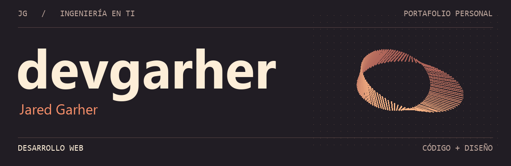

<h1 align="center">devgarher</h1>

## Sobre mí

Soy Jared Garher, estudiante de Ingeniería en Tecnologías de la Información. Me gusta llevar lo que aprendo en clase al navegador. Ahora estoy profundizando en desarrollo web, desde cómo se organiza una página con HTML hasta cómo responde a una interacción con JavaScript.

### Tecnologías con las que trabajo y aprendo

| Área | Tecnologías |
| --- | --- |
| Interfaces web | HTML, CSS, JavaScript, React, Sass y Bootstrap |
| Servidor y bases de datos | Node.js, PHP y MySQL |
| Programación y algoritmos | Java, C, C++, Kotlin y PSeInt |
| Datos y cálculo | Python, pandas y MATLAB |
| Desarrollo móvil y diseño | Android, Illustrator y Photoshop |

 Fuera del código, disfruto de la música y la buena comida.

### Contacto

Puedes escribirme a [garher.jared@gmail.com](mailto:garher.jared@gmail.com).
